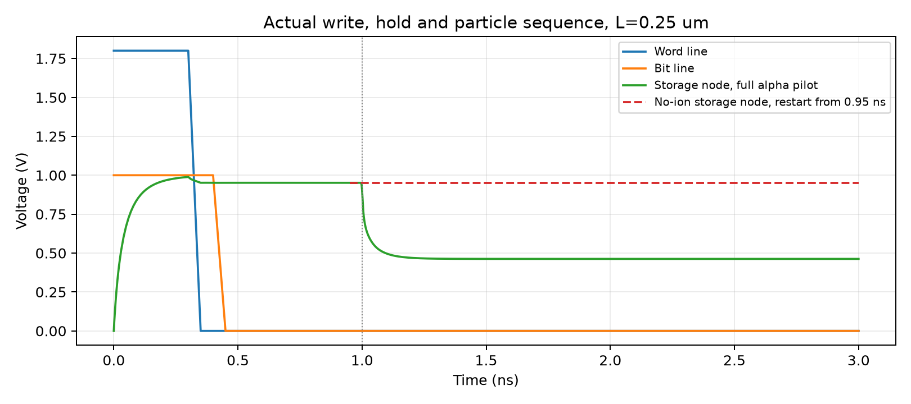
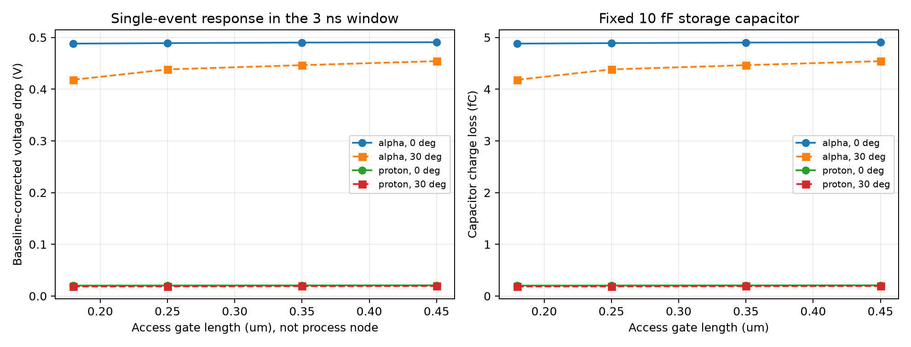
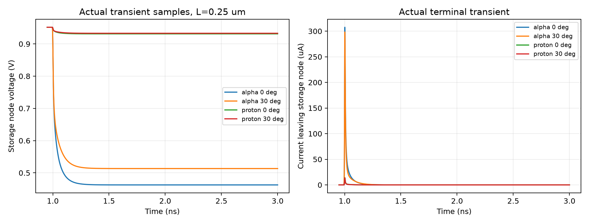
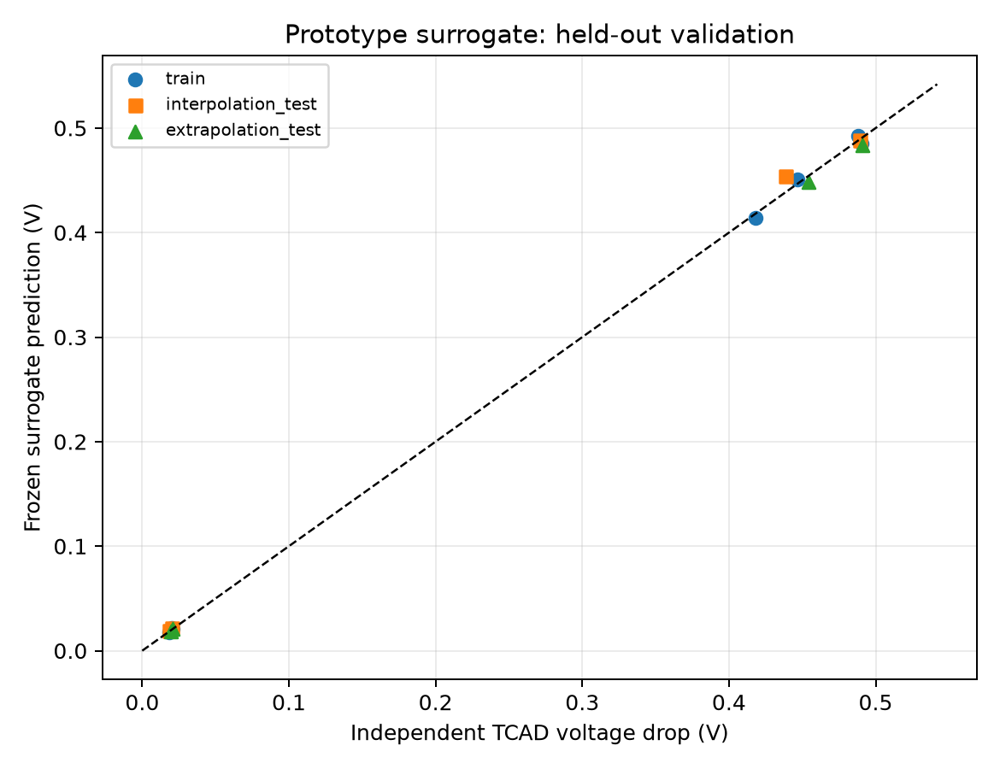

# AI 辅助多尺寸 DRAM 单粒子效应评估：第一版实验报告

日期：2026-10-09。本报告对应用户授权的自主探索实验。本轮矩阵、预测及代表点数值检查已完成；不等同于教师审定方案或校准器件的科研结论。

## 实验问题

在同一简化 1T1C 单元中改变访问晶体管栅长，分别施加 5 MeV alpha/proton、0°/30° 入射，能否贯通粒子输运、器件响应、参数扫描和留出预测？本轮重点是证明这条链路可以在现有 VM 上真实运行、可追溯并能被独立检查。

大纲要求实验室模型、AI 交互、Geant4→TCAD 参数传递及拟合外推。本轮没有取得实验室交接 DRAM 模型，所以采用自编二维平面 NMOS 与理想电容构成探索性 1T1C。已有 PN/VDMOS 结果没有混入本实验。老师给出的题目与要求保存在 [大纲提取稿](../../docs/course-project-syllabus.md)。

## 方法和固定假设

### 器件和电路

硅宽为 L+0.6 µm、深为 1.2 µm，二维有效厚度 1 µm；栅氧厚 5 nm，体掺杂 1e17 cm⁻³，源漏峰值 1e20 cm⁻³，结深参数 0.12 µm。L=0.18/0.25/0.35/0.45 µm 表示本模型的栅长，不能当成商业 DRAM 的工艺节点。各尺寸固定 10 fF 理想存储电容，温度 300 K。

使用漂移扩散、Fermi、OldSlotboom、掺杂/高场/表面迁移率、SRH 和 Auger。字线从 1.8 V 在 0.30–0.35 ns 关断，位线从 1 V 在 0.40–0.45 ns 降至 0 V。存储节点由访问管实际充电；0.95 ns 保存状态，1 ns 注入事件，观测至 3 ns。无粒子对照使用相同尺寸、网格和已保存的充电状态。

统一的是写入/关断波形，没有强制各尺寸的粒子前 SN 电压完全相同。栅长变化会同时影响实际写后状态，逐点结果因此保留 prestrike 电压；尺寸响应包含这部分初态差异。无粒子扣除去除对应保持段漂移，不能消除不同初态电压对收集过程的影响。

同尺寸续算只用于已验证的父归档，不能跨几何复用。在 L=0.25 µm 同事件上，全程与续算的电压扰动差约 3e-15 V，低于预设 1e-4 V 门槛，见 [续算核对](data/restart-validation.json)。该验证针对本次确定性输入，不是任意修改后的兼容性保证。

### 真实粒子输运和接口

VM 中运行官方 Geant4 10.7.3 CentOS7 二进制库和自编 C++ 输运程序。Si 体积与 TCAD 衬底一致，另有 1 µm 出平面厚度；上方为真空，粒子从表面外 1 nm 发射，在存储节点侧 x=L+0.45 µm 入射。方向为相对 +y 向 −x 偏转 0°/30°。使用 EM option4，最大几何步长 0.02 µm、产生阈值长度 0.01 µm，固定随机种子 20261009，每个工况一个事件。

每步记录坐标、时间、沉积能、非电离能和轨迹标识。只将电离沉积 E 转为电子空穴对及等效电荷：

\[
Q=E_{\mathrm{ion}}[\mathrm{MeV}]\frac{10^6}{3.6}\,q_e,
\qquad LET_{\mathrm{eq}}=Q/\ell.
\]

接口将总电荷均匀分配到几何直径迹，HeavyIon 使用 StartPoint 单向 Gaussian、半径 0.03 µm、PicoCoulomb 单位和 1 µm 二维厚度。真实三维横向、纵向及时间分布被简化；不是三维逐点沉积映射。当前 Geant4 只做电磁作用，不包括核反应、封装和互连堆叠。

初始 alpha 事件电离沉积为 0.172102453358163 MeV，Q=7.659403595125654 fC；独立同种子运行的逐步 CSV 与事件 CSV 逐字节相同。环境、来源与二进制重建证据见 [environment.md](environment.md)。每个新粒子输入冻结事件 JSON、两份原始 CSV 及哈希；早期 pilot 和首个续算因改进前已完成，明确标为外部事件交叉核验，未重写历史输入。

### 目标量与数值检查

目标为 0.95–3 ns 存储节点电压下降，并减去同尺寸无粒子对照的变化；电容损失为固定 C 乘以校正电压变化。该窗口内的响应不是完整长期保持试验，没有感放/阵列，不能由此直接宣称真实位翻转、截面或概率。

每个纳入结果的运行检查：runner 完成与归档哈希、SDevice 完成标志、最终时间/保持偏压、有限数据、写入状态、节点 KCL、端电流与电容电荷、TCAD 生成率源项积分。后向欧拉的离散守恒使用右端点积分；另保留梯形积分作为连续积分近似，二者差异进入数值敏感性讨论。

预先规定源项积分偏差不超过 5%；代表点细化比较采用电压 max(0.01 V, 5% 响应)、电荷 max(0.1 fC, 5% 响应) 门槛。一次代表点的两级比较只能支持局部敏感性结论，不能称为整个矩阵的严格网格独立性证明。

### AI 交互和预测边界

本轮由 AI 编写、检查并操作脚本；提供限定中文模板编译器，将自然语言形式的请求变成可审查矩阵，拒绝歧义、非法参数和超预算任务。它是确定性模板解析，尚未实现通用 LLM 语义理解接口。

16 个物理工况及分组在读取正式响应前冻结：L=0.18/0.35 的 8 点训练，L=0.25 的 4 点域内留出，L=0.45 的 4 点域外测试。相同物理条件不跨集合；同事件重跑只作复验。固定四特征 `[1, Q, Q/L, Q*sin(angle)]` 做普通最小二乘，Q 单位为 fC，并与训练均值基准比较。没有按测试误差改模型或换点。

各工况共用固定种子，部分几何下可能得到相同沉积能；这里的留出是未参与拟合的尺寸工况，不是独立随机事件统计。其误差只评价这个确定性矩阵上的插值/外推，不能据此给出总体置信区间。

预测输入包含真实 Geant4 沉积 Q，因此这只是省略 TCAD 响应求解的两阶段代理模型，不是从粒子种类/能量直接预测效应的独立模型。每种条件只有一个固定事件，尚不能量化统计不确定性或泛化到新的能量/随机事件。

0.05 V 是预设的绝对误差目标；对于约几十 mV 的低幅值响应，该门槛可能比信号本身还大。因此必须同时看逐点真实幅值和误差，不能仅凭“低于 0.05 V”宣称相对精度很高。

## 完整矩阵结果

16/16 个正式粒子工况均完成到 3 ns，通过归档、源项积分及电路检查。4 个尺寸分别有无粒子对照；失败调试不计入有效样本。派生表见 [scalars.csv](data/scalars.csv)、[predictions.csv](data/predictions.csv) 和 [results.json](data/results.json)。

本矩阵校正电压下降范围为 0.018553–0.490764 V。源项积分相对偏差范围 0.2036%–1.2422%，均低于预定 5%；最大节点 KCL 残差 4.346e-12 A。

### 写入与匹配对照

| 栅长 (µm) | 粒子前存储电压 (V) | 对照保持段下降 (V) |
|---|---:|---:|
| 0.18 | 0.962424118 | 2.280e-07 |
| 0.25 | 0.951610250 | 1.904e-09 |
| 0.35 | 0.910673944 | 3.135e-10 |
| 0.45 | 0.867510486 | 1.675e-10 |

极小的对照漂移是本离散解的诊断值，不是经过校准的泄漏精度。相同写入波形下不同尺寸的初始 SN 电压存在差异，不能忽略这项影响。

### 逐点响应与预测

下表为扣除匹配对照后的电压下降。误差 = 预测 − TCAD；训练点只表示拟合误差，域内和域外组才用于留出评价。Q 是对应 Geant4 事件的电离沉积换算量。

| L (µm) | 粒子 | 角度 | 分组 | Q (fC) | TCAD ΔV (V) | 预测 (V) | 误差 (mV) |
|---|---|---:|---|---:|---:|---:|---:|
| 0.18 | alpha | 0° | 训练 | 7.65940 | 0.488108 | 0.492682 | +4.574 |
| 0.18 | alpha | 30° | 训练 | 7.94049 | 0.418206 | 0.413791 | -4.415 |
| 0.18 | proton | 0° | 训练 | 0.42286 | 0.020260 | 0.021576 | +1.316 |
| 0.18 | proton | 30° | 训练 | 0.44048 | 0.018553 | 0.017332 | -1.221 |
| 0.25 | alpha | 0° | 域内 | 7.65940 | 0.489019 | 0.488518 | -0.501 |
| 0.25 | alpha | 30° | 域内 | 8.79156 | 0.438240 | 0.454000 | +15.760 |
| 0.25 | proton | 0° | 域内 | 0.42286 | 0.020395 | 0.021347 | +0.952 |
| 0.25 | proton | 30° | 域内 | 0.47791 | 0.018694 | 0.019051 | +0.357 |
| 0.35 | alpha | 0° | 训练 | 7.65940 | 0.490138 | 0.485459 | -4.679 |
| 0.35 | alpha | 30° | 训练 | 8.79156 | 0.446428 | 0.450489 | +4.061 |
| 0.35 | proton | 0° | 训练 | 0.42286 | 0.020592 | 0.021178 | +0.585 |
| 0.35 | proton | 30° | 训练 | 0.47791 | 0.019081 | 0.018860 | -0.221 |
| 0.45 | alpha | 0° | 域外 | 7.65940 | 0.490764 | 0.483759 | -7.005 |
| 0.45 | alpha | 30° | 域外 | 8.79156 | 0.454143 | 0.448538 | -5.605 |
| 0.45 | proton | 0° | 域外 | 0.42286 | 0.020767 | 0.021084 | +0.317 |
| 0.45 | proton | 30° | 域外 | 0.47791 | 0.019481 | 0.018754 | -0.727 |

图中标记为实际求解工况，线段仅连接采样点，中间不是新增求解。电荷为固定 10 fF 电容对应的损失，与电压变化不是两项独立统计证据。

瞬态图直接使用 L=0.25 µm 的实际求解时刻；续算从 0.95 ns 开始，未合成缺失的写入段。

### 拟合与留出评价

域内四点响应在系数文件冻结前已经可见，虽然独立重算确认这些点没有参与 OLS 系数拟合、特征也没有按其误差调整，但这组结果只称为留出评价，不称严格的前瞻盲测。域外四点的前瞻性由下述单独预登记记录支持。

2026-10-09 18:23:58 UTC 冻结四个系数，当时域外粒子响应数为 0；见 [model-frozen.json](data/model-frozen.json)。四个域外工况另在参考求解完成前用真实 Geant4 Q 登记预测，见 [extrapolation-forecasts.json](data/extrapolation-forecasts.json)。最终汇总系数与冻结版本一致。

| 分组 | 点数 | MAE (mV) | 最大绝对误差 (mV) | RMSE (mV) | 训练均值基准 MAE (mV) | 50 mV 目标 |
|---|---:|---:|---:|---:|---:|---|
| 训练 | 8 | 2.634 | 4.679 | 3.210 | 220.549 | 满足 |
| 域内 | 4 | 4.392 | 15.760 | 7.901 | 222.042 | 满足 |
| 域外 | 4 | 3.414 | 7.005 | 4.503 | 226.165 | 满足 |

域内最大误差出现在 L=0.25 µm、30° alpha，为约 15.76 mV；域外最大误差出现在 L=0.45 µm、0° alpha，为约 7.01 mV。两组均满足本轮预设绝对误差目标。小样本、固定种子及简化物理模型限制仍然成立，不据此推广到真实器件或其他能量。

### 真实场图与桌面

[结构/掺杂](figures/structure.png)、[实际网格](figures/mesh.png)、[1 ns 电场](figures/strike-field.png)、[电子密度](figures/strike-electrons.png) 和 [真实 Visual 桌面](figures/native-desktop.png) 均来自成功 pilot 的 TDR，证据哈希见 [gui-evidence.json](data/gui-evidence.json)。场图显示该时刻的总场/总载流子密度，未减去无粒子场，不能将全部场值归因于辐射。

### 代表点数值细化

L=0.25 µm、垂直 alpha 的粗/细完整运行及各自无粒子对照均完成并通过分析。网格 scale 从 1 改为 0.7，节点从 7,384 增至 9,268、单元从 14,400 增至 17,928；最大时间步 scale 从 1 改为 0.5。保持物理参数、事件、电路和目标时刻不变，各自对照恢复各自保存的充电状态。

| 检查量 | 粗网格/原时间步 | 细网格/半时间步 | 绝对差 | 预定容差 |
|---|---:|---:|---:|---:|
| 校正 ΔV (V) | 0.4890186960 | 0.4893683808 | 0.0003496847 | 0.0244509348 |
| 校正电容损失 (fC) | 4.8901869603 | 4.8936838077 | 0.0034968474 | 0.2445093480 |

两项均通过，电压差约 0.35 mV（约粗网格响应的 0.0715%）。电荷与电压通过固定电容直接相关，不是两项独立验证。原始数值、run IDs 及阈值见 [numerical-validation.json](data/numerical-validation.json)，可直接审阅的冻结 deck 见 [reference-inputs](reference-inputs/README.md)。

BE 与梯形电流积分之差从 0.072161 fC 降到 0.038032 fC；源项积分偏差则从 0.2175% 增至 0.7095%，两者均在 5% 门槛内。因此不能笼统声称所有误差随细化单调变小。这个两级、同时改变空间与时间离散的检查，只支持该代表点的组合敏感性通过，不给出独立收敛阶，也不证明全部工况网格独立。

## 运行成本与全体尝试

[运行索引](run-index.json) 共记录 31 次 TCAD 尝试：26 次 COLLECTED、5 次 FAILED_COLLECTED。26 次成功包括 16 个正式粒子点、4 个匹配对照、4 个完整父运行及 2 个细化验证运行；只有前 16 个是本矩阵的响应样本。失败/中断没有删除，也未把重复运行当新样本。

SDevice 日志完成行累计 7,825.24 s（130.42 分钟），含两次求解完成但预期产物命名错误的失败归档；不含被中断求解、环境准备、传输、GUI、分析与等待时间。因此它不是整个项目的端到端耗时，也不能用于宣称 AI 加速比。细化粒子和对照的求解完成行分别为 826.45 s、293.82 s。[操作索引](data/operations-index.json) 另收录 35 项环境、输运、编译及 GUI 操作证据。

## 复盘与复现入口

- [journal.md](journal.md)：失败、文件名修正、ExtendedPrecision 成本试验、元数据绑定和 GUI 导出修正。
- [workflow.md](workflow.md)：逐步复现命令、状态恢复、输入/输出定位及交付边界。
- [plan.md](plan.md)：原始假设、阈值、预算及来源。
- `local_runtime/runs/<run-ID>/`：冻结输入、console.log、manifest 和完整结果 tar。
- `local_runtime/dram-see-v1/operations/`：环境、探测、编译、输运和 GUI 操作命令/输出/时间/退出码。

本轮没有提交或推送 Git，没有更改许可证或系统软件，没有中断用户已有仿真和 GUI。当前会话未取得仓库历史指定模型配置的运行证明，不声明由指定模型完成科研验收。

## 下一版的顺序

1. 首先接入实验室提供的 DRAM 结构与参考结果，明确尺寸定义、偏压、电容和感测条件，做基本电学/写入/保持校准。当前脚本和证据链可复用，不能把这组探索性参数当作校准结果继续大规模扩展。
2. 对粒子径迹的纵向分段沉积和三维到二维归一化做更细致的传递验证，再讨论增加层叠材料与适用的粒子物理过程。先区分源项映射误差与器件响应误差。
3. 增加独立随机种子与统计重复，并分别细化空间网格、时间步、Geant4 步长/阈值；按目标量确定观测窗口是否足够。基于校准模型定义读取/翻转判据后，才讨论失效概率或截面。
4. 将限定模板扩展为经过验证的 LLM→结构化参数接口，保留白名单、预算和输入差异审查。再增加一个有物理来源的工艺变量与能量扫描，检验新的域外条件；不要靠更多数据掩盖模型来源不足。
5. 学生完成实际分工、教师审核、文献阅读与答辩演练。此次工程实验及报告草稿可作讨论材料，不表示课程的全部验收要求已经满足；也没有进行 AI 与手工流程的效率对照，不能报告 AI 加速比。
