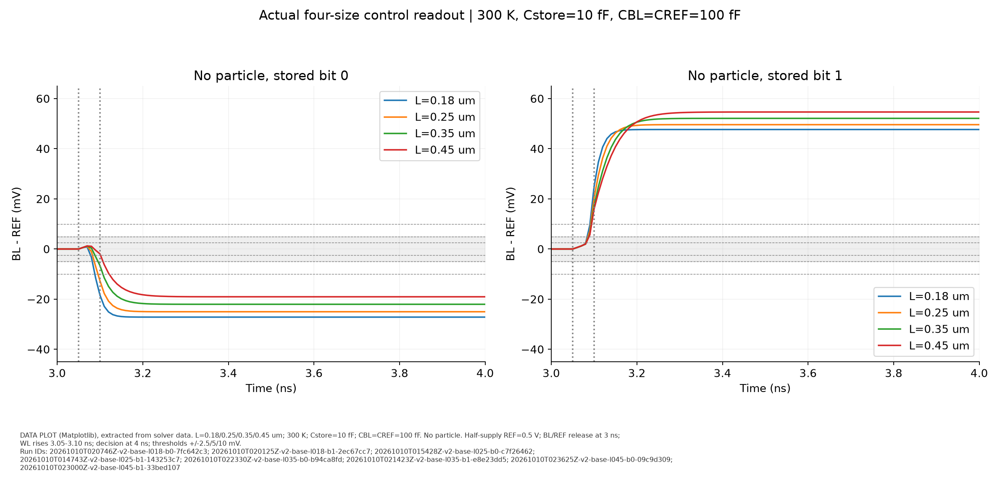
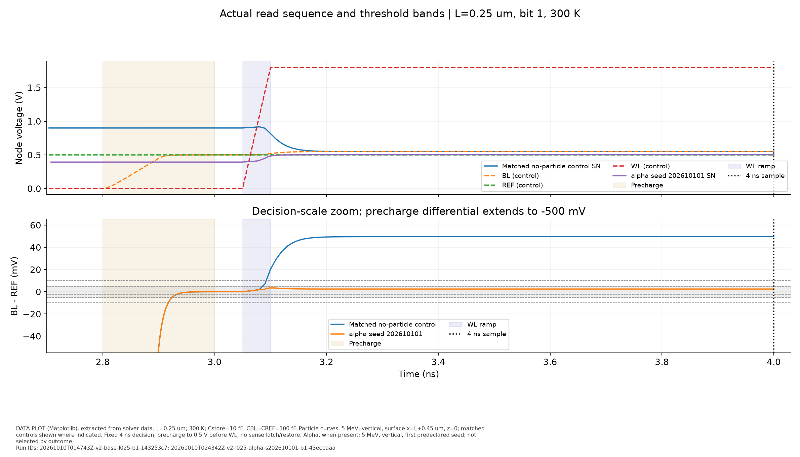
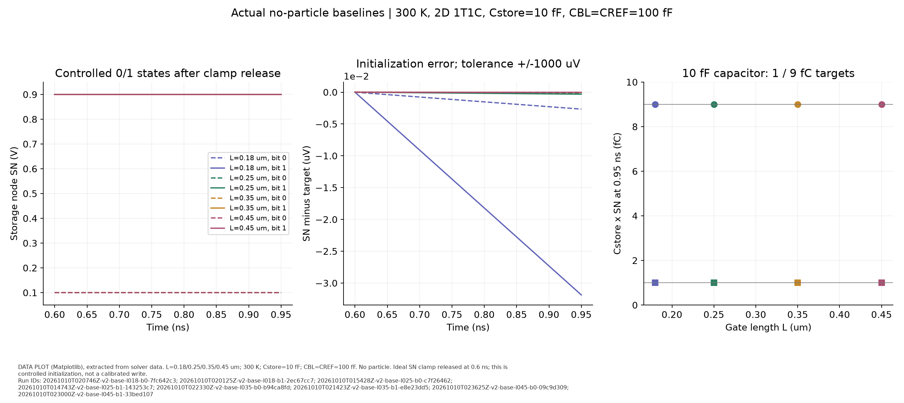
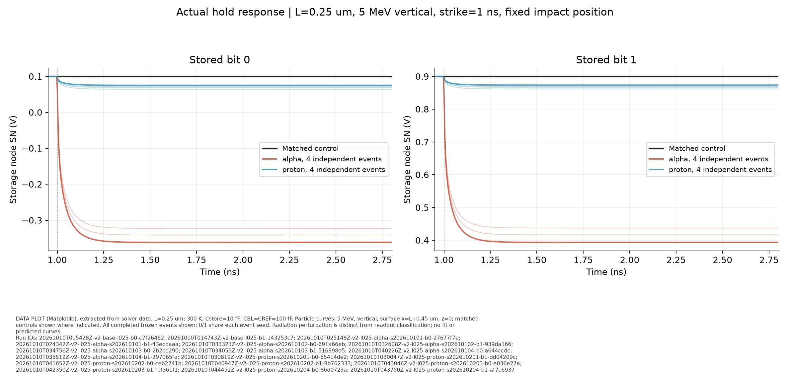
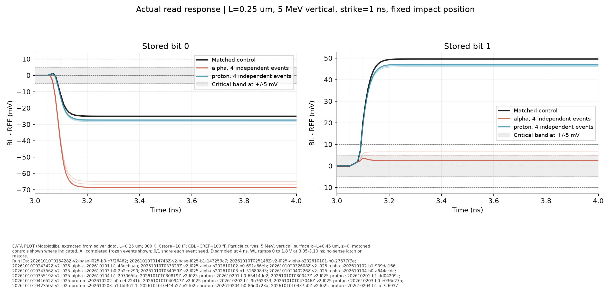
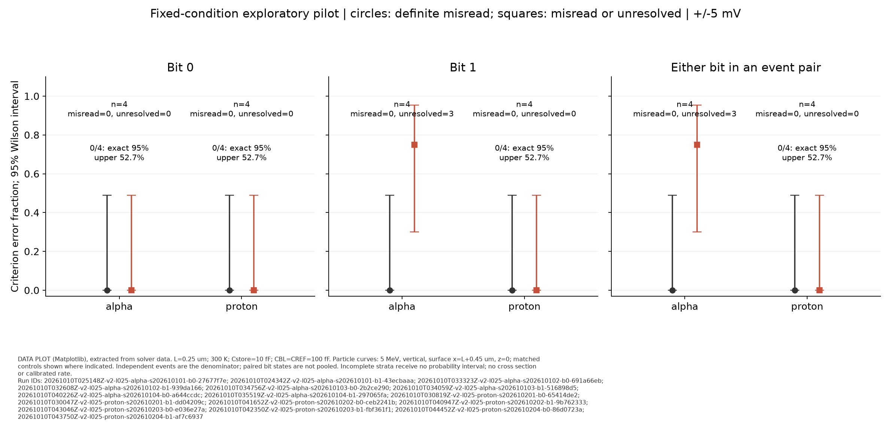
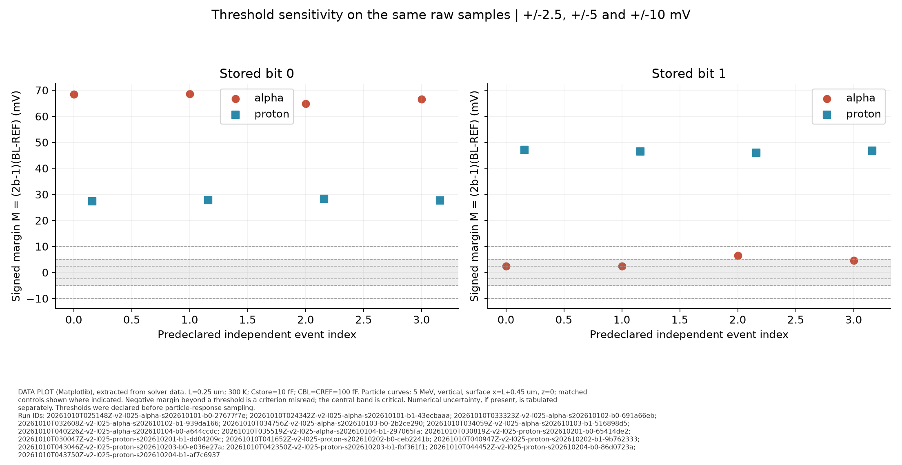
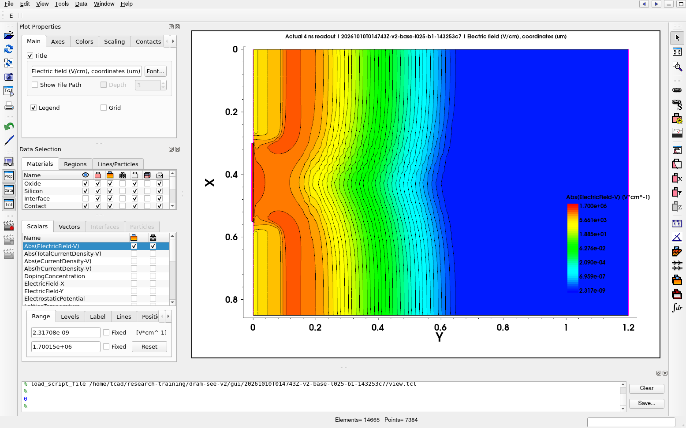

# DRAM 单粒子效应 v2 实际结果与操作说明

生成时间：2026-10-10T05:16:47.440239+00:00。状态：**主实验样本已完成**。数据来自本机/已授权虚拟机的实际 Geant4 与 Sentaurus 输出，未使用拟合预测补点。

## 本次实际完成范围

- 统一初态基准：8/8，覆盖 0.18、0.25、0.35、0.45 μm × 存储 0/1；当前缺少的组合不可视为完成。
- 冻结独立事件：8 个预定事件，已完成源 8 个，已完成 TCAD 位值响应 16 个。每个源配对 0/1，不能把响应数当成独立粒子数。
- 当前 v2 原始运行归档共 30 次，其中成功工程审计 28 次；包括调试和数值验证，后两类不充作独立统计样本。
- v1 保留检查：原有 210 个文件逐字节 SHA-256 对比，结果 全部保持且无新增文件。

## 模型、输入与判据

这是**未校准的二维平面 NMOS + 10 fF 电容的 1T1C 探索模型**，并非真实 DRAM 工艺节点或完整存储阵列。几何延续 v1：硅深 1.2 μm，宽 L+0.6 μm；栅氧 5 nm；P 型体掺杂 1e17 cm⁻³，源漏高斯峰值 1e20 cm⁻³、特征深度 0.12 μm；栅功函数 4.6 eV，温度 300 K，有效第三维厚度 1 μm。使用 Fermi、OldSlotboom、掺杂/高场/法向场迁移率及 SRH/Auger 复合。基准网格沿用原几何生成器；误差设置 Digits=5，ErrRef=1e7，BE 瞬态、Blocked/ParDiSo，单线程执行。

存储 0/1 的 SN 目标电压分别为 **0.1/0.9 V**，对应外接存储电容的 **1/9 fC**；这只代表 Cstore×V，不能当成器件所有结电容的总电荷。初态用理想 SN 夹位到 0.6 ns，WL 保持 0 V，随后释放 SN；0.95 ns 验证电压误差不超过 1 mV。该做法是明确的受控初始化假设，尚未验证真实访问管写入路径或写入能耗。它解决了 v1 各尺寸写入后的初态不完全一致问题，也改变了工作状态，不能把新旧电压跌落作无条件同比。

粒子在 1 ns 注入。保持阶段结束于 2.8 ns；BL 由 100 Ω 预充电阻连接电源，2.8–2.9 ns 从 0 升到 0.5 V，保持到 3 ns，容差 10 μV。3 ns 将电阻改成 1e20 Ω，BL/REF 都成为 100 fF 的浮置电容节点。WL 在 3.05–3.10 ns 从 0 升到 1.8 V，4 ns 固定采样。REF 是简化的 0.5 V 参考支路。

定义 D=V(BL)−V(REF)，M=(2b−1)D。预先声明主判据 ε=5 mV：**M>ε 正确；M<−ε 为判据误读；其余为临界/不确定**。同一原始样本同时检查 ε=2.5/5/10 mV，未按观察结果修改阈值。相应无粒子对照必须在所有阈值下可读。阈值是探索用裕量预算，没有实测感放失调/噪声校准。模型没有锁存器和恢复电路，所以“判据误读”不能等同于物理上已经持久翻转并保持。

Geant4 使用既有 10.7.3 的 EM-only option4 + StepLimiter 构建，5 MeV α/质子，垂直入射，固定表面位置 x=L+0.45 μm、z=0，每个唯一 seed 单事件。逐步电离能量原始 CSV 被保留；按 3.6 eV/电子空穴对转换成 Q，再以半径 0.03 μm、长度 1.2 μm、均匀 LET 的二维 HeavyIon 近似注入。该映射保留事件电离总电荷，未忠实迁移三维逐步轨迹分布。没有强相互作用/核反应物理、面积/通量归一化，不能推导质子真实 SEE 截面或轨道误码率。

## 统一初态与无粒子读出

| L (μm) | 位值 | 入射前 SN (V) | 电容电荷 (fC) | 初态误差 (mV) | 4 ns D (mV) | M (mV) | 5 mV 判据 |
|---:|---:|---:|---:|---:|---:|---:|---|
| 0.18 | 0 | 0.0999999973 | 0.99999997 | -2.66e-06 | -27.1611 | 27.1611 | correct |
| 0.18 | 1 | 0.8999999681 | 8.99999968 | -3.19e-05 | 47.6724 | 47.6724 | correct |
| 0.25 | 0 | 0.0999999999 | 1.00000000 | -1.47e-07 | -25.0193 | 25.0193 | correct |
| 0.25 | 1 | 0.8999999997 | 9.00000000 | -3.1e-07 | 49.6043 | 49.6043 | correct |
| 0.35 | 0 | 0.1000000000 | 1.00000000 | -4.08e-08 | -22.0469 | 22.0469 | correct |
| 0.35 | 1 | 0.8999999999 | 9.00000000 | -5.34e-08 | 52.1146 | 52.1146 | correct |
| 0.45 | 0 | 0.1000000000 | 1.00000000 | -2.36e-08 | -19.0561 | 19.0561 | correct |
| 0.45 | 1 | 0.9000000000 | 9.00000000 | -2.88e-08 | 54.6533 | 54.6533 | correct |

已完成基准的最大初态误差为 3.18634e-05 mV；目标容差为 1 mV。0/1 的读出裕量可以不对称：打开 WL 后除电容共享外，还有栅耦合及源漏结电荷交换，因此不应用单纯 10/(10+100) 的电容分压替代实际 D。对照和粒子使用同电路、同网格/步长、同位值的已保存初态，粒子保持段电荷损失和读出裕量退化分别给出。

无粒子对照在0.95–2.8 ns保持窗口内的最大SN绝对漂移为 0.000168412 mV；4 ns最小有符号读出裕量为 19.0561 mV。这只验证所设短时间窗。







## 独立事件与实际响应

冻结设计时间 2026-10-10T02:43:38.577837+00:00；每种粒子 n=4，仅 L=0.25 μm。事件数按基准成本和 14400 秒 solver 预算事先固定，范围为**小样本 pilot**；没有完成其他尺寸的粒子统计扫描。

| 粒子 | seed | 源电荷 (fC) | 位值 | 保持段对照修正损失 (fC) | 4 ns M (mV) | ε=5 mV 结果 |
|---|---:|---:|---:|---:|---:|---|
| alpha | 202610101 | 7.92442 | 0 | 4.61178 | 68.5242 | 正确 |
| alpha | 202610101 | 7.92442 | 1 | 5.06322 | 2.4503 | 临界 |
| alpha | 202610102 | 7.93783 | 0 | 4.62034 | 68.6056 | 正确 |
| alpha | 202610102 | 7.93783 | 1 | 5.07296 | 2.3594 | 临界 |
| alpha | 202610103 | 7.32443 | 0 | 4.22619 | 64.8607 | 正确 |
| alpha | 202610103 | 7.32443 | 1 | 4.62717 | 6.5200 | 正确 |
| alpha | 202610104 | 7.61083 | 0 | 4.41068 | 66.6133 | 正确 |
| alpha | 202610104 | 7.61083 | 1 | 4.83479 | 4.5825 | 临界 |
| proton | 202610201 | 0.54727 | 0 | 0.24669 | 27.3326 | 正确 |
| proton | 202610201 | 0.54727 | 1 | 0.26546 | 47.1368 | 正确 |
| proton | 202610202 | 0.67786 | 0 | 0.30839 | 27.9113 | 正确 |
| proton | 202610202 | 0.67786 | 1 | 0.33195 | 46.5187 | 正确 |
| proton | 202610203 | 0.77978 | 0 | 0.35724 | 28.3696 | 正确 |
| proton | 202610203 | 0.77978 | 1 | 0.38461 | 46.0291 | 正确 |
| proton | 202610204 | 0.62999 | 0 | 0.28565 | 27.6981 | 正确 |
| proton | 202610204 | 0.62999 | 1 | 0.30744 | 46.7465 | 正确 |

alpha 已完成 4 个独立源，Q 范围 7.32443–7.93783 fC，均值 7.69938 fC，样本标准差 0.29208 fC。

proton 已完成 4 个独立源，Q 范围 0.54727–0.77978 fC，均值 0.65872 fC，样本标准差 0.09707 fC。





曲线中的黑线为匹配对照，彩色线为实际独立事件；淡色曲线也属于同一冻结组。保持段的 SN 变化描述电荷扰动，3–4 ns 的差分才决定本判据下的读出。访问管打开会共享电荷并产生寄生耦合；粒子引起的电子空穴对经漂移/扩散、复合和终端收集改变 SN。源 Q 不等于存储电容净损失，后者由终端电流与电容变化分别核验。

## 小样本统计与阈值敏感性

| 粒子 | 位值/事件对 | ε (mV) | 完成/预定 n | 正确/临界/数值不确定/明确误读 | 明确误读 Wilson 95% | 未观察明确误读的 exact 单侧 95% 上界 |
|---|---|---:|---|---|---|---|
| alpha | 0 | 2.5 | 4/4 | 4/0/0/0 | 0.0%–49.0% | 52.7% |
| alpha | 1 | 2.5 | 4/4 | 2/2/0/0 | 0.0%–49.0% | 52.7% |
| alpha | 任一位（同事件对） | 2.5 | 4/4 | 2/2/0/0 | 0.0%–49.0% | 52.7% |
| alpha | 0 | 5 | 4/4 | 4/0/0/0 | 0.0%–49.0% | 52.7% |
| alpha | 1 | 5 | 4/4 | 1/3/0/0 | 0.0%–49.0% | 52.7% |
| alpha | 任一位（同事件对） | 5 | 4/4 | 1/3/0/0 | 0.0%–49.0% | 52.7% |
| alpha | 0 | 10 | 4/4 | 4/0/0/0 | 0.0%–49.0% | 52.7% |
| alpha | 1 | 10 | 4/4 | 0/4/0/0 | 0.0%–49.0% | 52.7% |
| alpha | 任一位（同事件对） | 10 | 4/4 | 0/4/0/0 | 0.0%–49.0% | 52.7% |
| proton | 0 | 2.5 | 4/4 | 4/0/0/0 | 0.0%–49.0% | 52.7% |
| proton | 1 | 2.5 | 4/4 | 4/0/0/0 | 0.0%–49.0% | 52.7% |
| proton | 任一位（同事件对） | 2.5 | 4/4 | 4/0/0/0 | 0.0%–49.0% | 52.7% |
| proton | 0 | 5 | 4/4 | 4/0/0/0 | 0.0%–49.0% | 52.7% |
| proton | 1 | 5 | 4/4 | 4/0/0/0 | 0.0%–49.0% | 52.7% |
| proton | 任一位（同事件对） | 5 | 4/4 | 4/0/0/0 | 0.0%–49.0% | 52.7% |
| proton | 0 | 10 | 4/4 | 4/0/0/0 | 0.0%–49.0% | 52.7% |
| proton | 1 | 10 | 4/4 | 4/0/0/0 | 0.0%–49.0% | 52.7% |
| proton | 任一位（同事件对） | 10 | 4/4 | 4/0/0/0 | 0.0%–49.0% | 52.7% |

每种粒子每个位值的分母是独立事件 n；“任一位”先把同事件 0/1 合并为一次观察，再统计 n，没有把它算成 2n。不确定样本不归为正确；`statistics.csv` 另外给出“明确误读或不确定”的 Wilson 区间及零次上界。失败/未完成仍留在预定分母中：仅输出确定的样本下界和把不确定/缺失都算失败的上界，不对成功子集报告概率区间。

即使小组没有观察到明确误读，也不能称零概率或已证明可靠。exact 零次上界为 1−0.05^(1/n)，只针对这一固定条件、独立随机源和探索电路的条件频率；小样本不能证明尾部风险。

alpha在5 mV下的事件对统计：明确判据误读 0/4（0.0%），未确定正确 3/4（75.0%）；把明确误读与未确定正确合计为保守端点时为 75.0%，其Wilson 95%区间为 30.1%–95.4%。这不是把临界事件判成已误读。

proton在5 mV下的事件对统计：明确判据误读 0/4（0.0%），未确定正确 0/4（0.0%）；把明确误读与未确定正确合计为保守端点时为 0.0%，其Wilson 95%区间为 0.0%–49.0%。这不是把临界事件判成已误读。





## 工程验证、失败和边界

阶段清单：

- 无粒子基准：8/8；粒子配对响应：16/16。
- 完整/续算等价性：通过。
- 匹配对照时间步减半：通过。
- 未做：其他三个尺寸的粒子统计、全矩阵空间网格收敛、真实器件/写入/感放校准、跨能量及辐射截面评估。

已完成记录必须同时满足远程/SSH 退出 0、工程完成标志、SDevice 正常结束和实际到达 4 ns。重算所有输入/结果 SHA，检查正时刻节点电压连续、全部数据有限、初态与偏置、预充容差、逐时间步 KCL，以及保持/预充/读出 BE 右端点电荷积分。HeavyIon 实际空间/时间积分与 Geant4 转换 Q 的偏差须不超过 5%。恢复状态要求父归档摘要及完整模型 contract 一致，网格和两个状态文件逐字节对应。

3 ns 切换后的同时间重列行会保留上一步电容电流，因此不能把它当成新收敛步。原始行全部保留：预充 BE 采用切换前 first 终点，KCL 排除阶段起点，其他时间步用本步 1 pA + 0.1% 电流尺度检查；不靠整个阶段的大峰值掩盖局部失衡。初始 t=0 DC 列表与受控瞬态初始行可不同，正时刻不允许同时间电压跳变。

主实验已完成记录共出现 14 次 Newton 重试；实际源积分最大相对偏差为 0.218%。更多 KCL/BE 数值及求解器结束时间见每个 `data/tcad/<run-id>/summary.json`。

数值验证 `full_restart`：

```json
{
  "full_run_id": "20261010T031637Z-v2-validate-full-l025-alpha-s202610101-b1-78b9eddc",
  "restart_run_id": "20261010T024342Z-v2-l025-alpha-s202610101-b1-43ecbaaa",
  "D_difference_mV": 1.9984014443252818e-12,
  "prestrike_difference_mV": 0.0,
  "D_tolerance_mV": 0.1,
  "initial_tolerance_mV": 0.001,
  "passed": true,
  "same_source_event": "l025-alpha-s202610101",
  "bit": 1
}
```

数值验证 `half_step`：

```json
{
  "selection": "closest absolute signed margin to any predeclared 2.5/5/10 mV boundary among all frozen completed responses; validation selection only, no change to event cohort",
  "coarse_run_id": "20261010T024342Z-v2-l025-alpha-s202610101-b1-43ecbaaa",
  "fine_run_id": "20261010T050404Z-v2-validate-halfstep-l025-alpha-s202610101-b1-d9502d46",
  "coarse_control_run_id": "20261010T014743Z-v2-base-l025-b1-143253c7",
  "fine_control_run_id": "20261010T045256Z-v2-validate-halfstep-control-b1-7d0a349b",
  "coarse_D_mV": 2.4503010927919844,
  "fine_D_mV": 2.4162681286550303,
  "D_difference_mV": 0.034032964136954114,
  "control_D_difference_mV": 0.0006876769240715674,
  "control_corrected_D_difference_mV": 0.03472064106102568,
  "D_tolerance_mV": 0.5,
  "threshold_classifications": {
    "2.5mV": {
      "coarse": "uncertain",
      "fine": "uncertain",
      "control_coarse": "correct",
      "control_fine": "correct",
      "same_class": true,
      "numerically_uncertain": false
    },
    "5mV": {
      "coarse": "uncertain",
      "fine": "uncertain",
      "control_coarse": "correct",
      "control_fine": "correct",
      "same_class": true,
      "numerically_uncertain": false
    },
    "10mV": {
      "coarse": "uncertain",
      "fine": "uncertain",
      "control_coarse": "correct",
      "control_fine": "correct",
      "same_class": true,
      "numerically_uncertain": false
    }
  },
  "all_threshold_classes_stable": true,
  "passed": true,
  "coarse_class": "uncertain",
  "fine_class": "uncertain",
  "same_class": true,
  "only_temporal_refinement": true,
  "mesh_refinement_unverified": true,
  "bit": 1,
  "event": "l025-alpha-s202610101"
}
```

步长检查除原始差分、对照及对照修正差分均须在0.5 mV内，还要求2.5/5/10 mV全部登记判据的分类稳定；跨界样本的对应阈值统计标为数值不确定，原始分类另存CSV。单个代表点通过仍不证明全事件、全网格收敛。

结果原因单列：`critical_margin`表示原始裕量落在闭区间[−ε,+ε]内；`numerically_uncertain`表示粗/细步长分类不一致；二者在保守区间中都算未确定正确，但CSV分别计数。失败/缺失列为`missing_or_failed_n`并保留运行状态和失败原因，不能算作临界或正确。

保持检查仅覆盖本模型0.95–2.8 ns的设定窗口，不能推断实际DRAM刷新周期中的保持能力；4 ns读出也不等于感放锁存、恢复或下一读周期验证。

“任一位”是同一个源分别施加于存储0和存储1两种初态后的配对汇总，不代表已知实际存储位分布下的总体误码概率。两种初态的响应也不能当作两个独立粒子事件。

原始失败/调试记录（不进入独立事件统计）：

- `20261010T012717Z-v2-pilot-control-l025-b1-fed51e56`：runner=FAILED_COLLECTED，SSH=2，audit=not_complete。
- `20261010T013430Z-v2-pilot-control-l025-b1-r2-c2e79b3c`：runner=FAILED_COLLECTED，SSH=143，audit=not_complete。

最早 pilot 的静态预充 Coupled 使浮置电容节点失去瞬态约束，出现 Linear system cannot be solved；另一已被平滑预充方案取代的试跑按核实 PID/cwd 精确停止，退出 143。两次失败保留输入/日志/归档，没有被成功版本覆盖。r3 输入只生成未启动。r4 是成功调试试跑，但不充作带完整 contract 的正式基准。shell 的 locale 与缺失旧 devtoolset profile 提示也保留；它们与求解器退出码及数值失败分开记录，没有调整许可或系统安全配置。

通过的工程审计证明这套输入产生了可追溯且满足约定误差的数值结果。它仍不能证明真实 DRAM 的翻转概率/截面、全尺寸辐射趋势、真实写入/感放可靠性、完整空间网格收敛、质子核反应 SEE 或器件工艺校准。本次未使用机器学习拟合，因此这些结果不是拟合曲线或计划中的预测值。

## 证据与复现入口

- [操作步骤](workflow.md)、[实际日志](journal.md)、[冻结计划](plan.md)、`stats-design.json`（如已冻结）。
- [八基准 CSV](data/summary/baselines.csv)、[位值响应 CSV](data/summary/responses.csv)、[独立事件/缺失状态 CSV](data/summary/event-index.csv)、[完整统计 CSV](data/summary/statistics.csv)、[全部运行尝试 CSV](data/summary/all-run-attempts.csv)。
- 原始：`E:/TCAD-Workspace/tcad-research-training/local_runtime/runs/<run-id>/inputs.tar、results.tar、manifest.json、console.log`；每个实际运行 ID 和摘要在上述 CSV。
- [图件证据清单](figures/figure-evidence.json)：PNG/SVG 来自实际审计 CSV；[Visual 原生导出与真实窗口截图](figures/native/) 绑定实际 TDR 摘要，两者分别标注。
- [早期独立审查](validation/)和文末的本次接管复核分别保留适用范围。

## 真实 Sentaurus Visual 图形取证

L=0.25 µm，存储1，无粒子对照；300 K，Cstore=10 fF、CBL=CREF=100 fF，4 ns。显示电场模量，单位V/cm，空间坐标µm。run ID：`20261010T014743Z-v2-base-l025-b1-143253c7`。下图为真实软件窗口截图；旁存的`final-field-native.png`是Visual原生导出，两者均不是Matplotlib数据图。



L=0.25 µm，存储1，alpha，5 MeV，0°，seed=202610101；300 K，Cstore=10 fF、CBL=CREF=100 fF，4 ns。显示电场模量，单位V/cm，空间坐标µm。run ID：`20261010T024342Z-v2-l025-alpha-s202610101-b1-43ecbaaa`。下图为真实软件窗口截图；旁存的`final-field-native.png`是Visual原生导出，两者均不是Matplotlib数据图。


本次独立复核见 [接管审查](../../local_runtime/dram-see-v2/takeover-validation-20261010/report.md)及[首个粒子原始归档复算](../../local_runtime/dram-see-v2/takeover-validation-20261010/particle-recheck-20261010/report.md)。这些验证的范围以各自报告为准。

[最终原始数据与统计独立复核](../../local_runtime/dram-see-v2/takeover-validation-20261010/final-recheck/final-report.md)。

[交付文件与全部原始归档哈希索引](data/summary/delivery-index.json)由`deliverable_index.py`在全部运行停止写入后生成。
