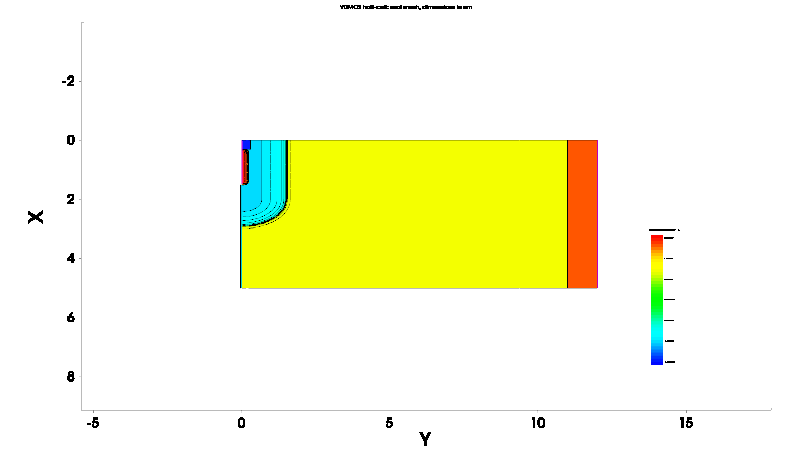
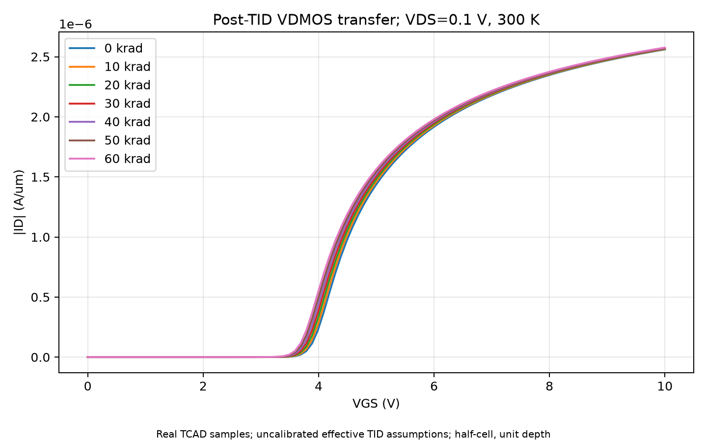
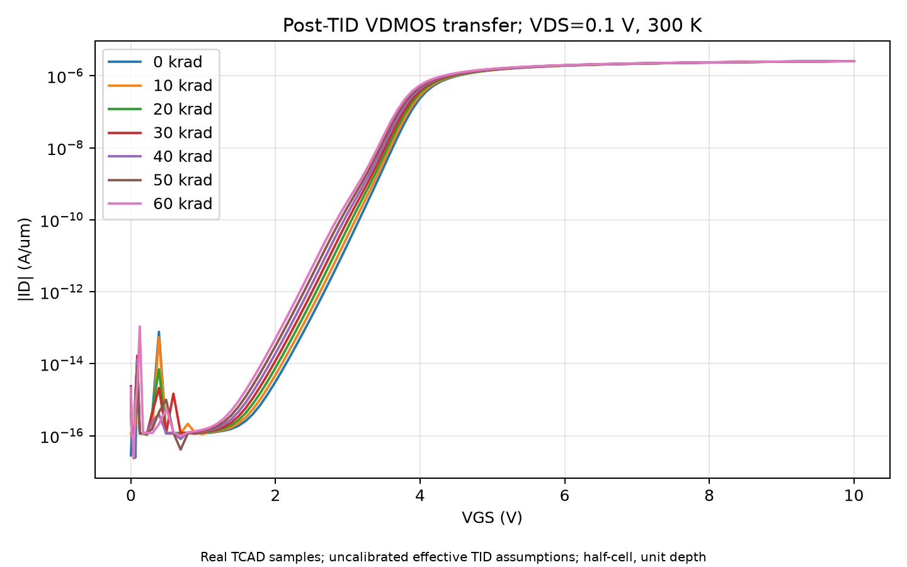
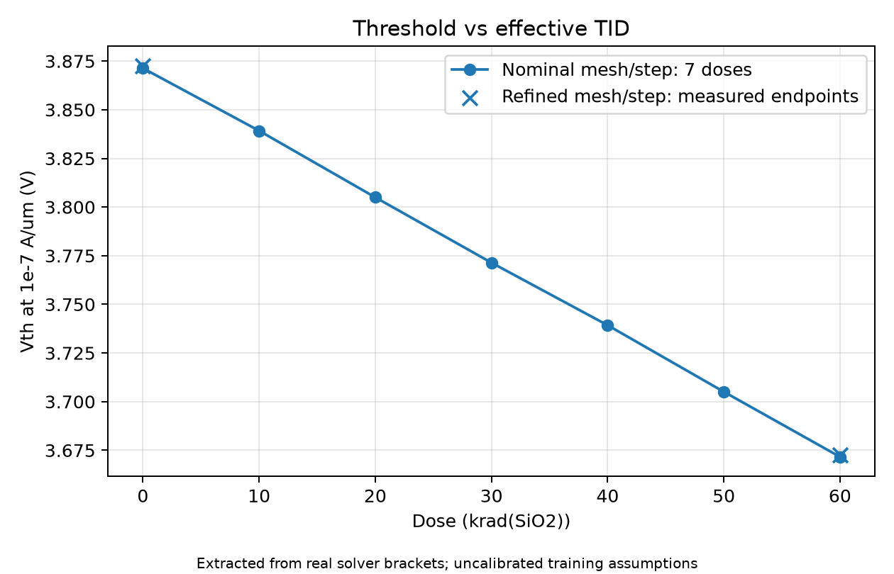
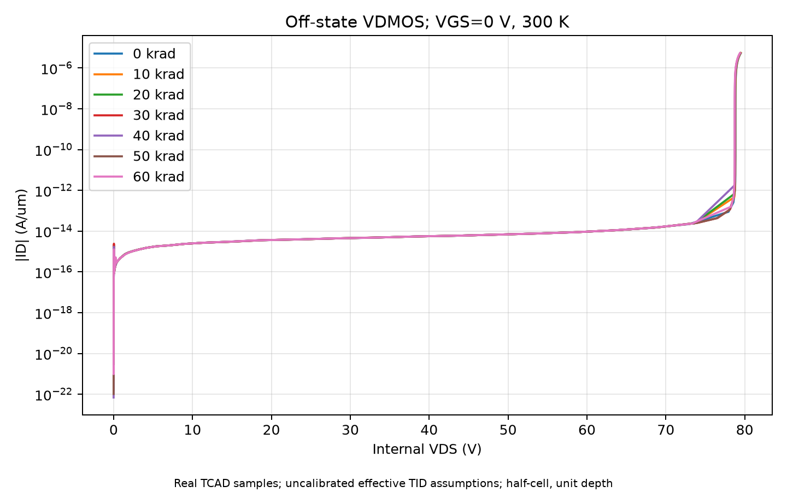
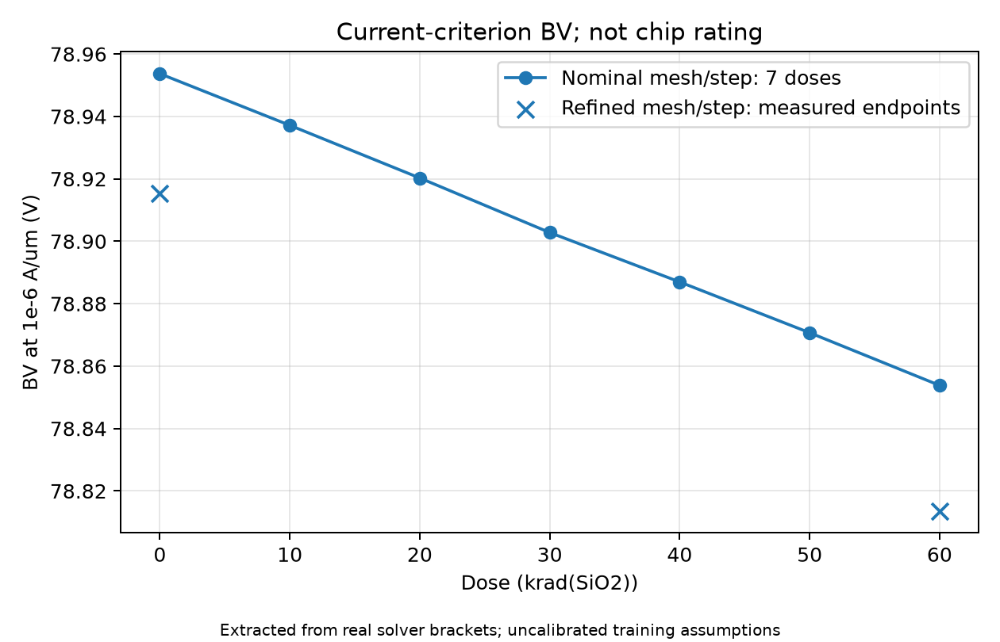
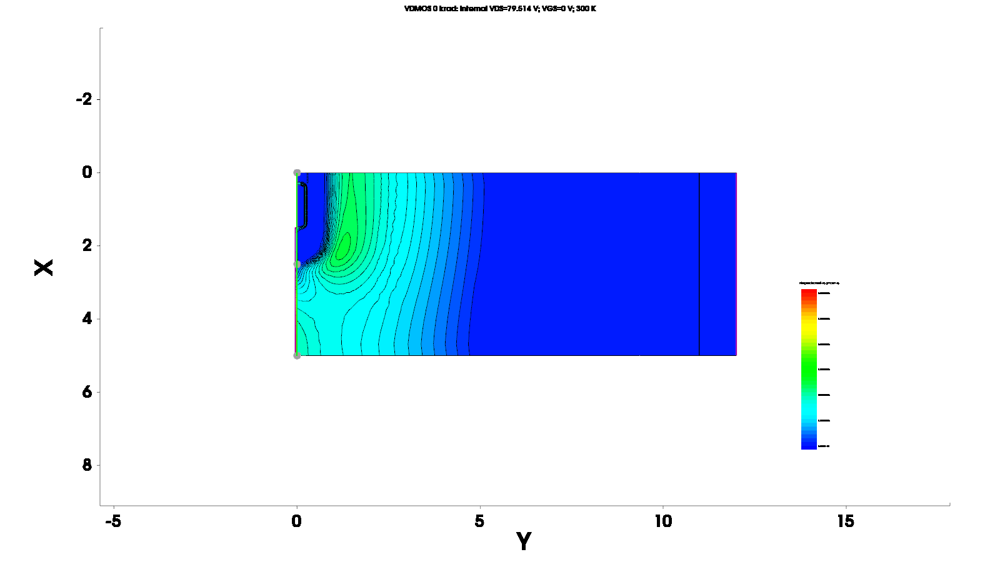
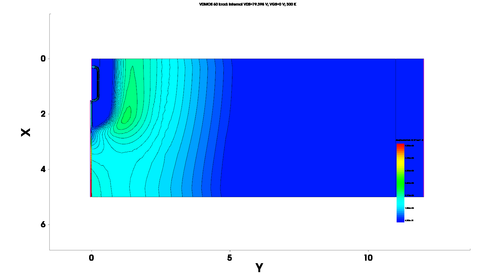
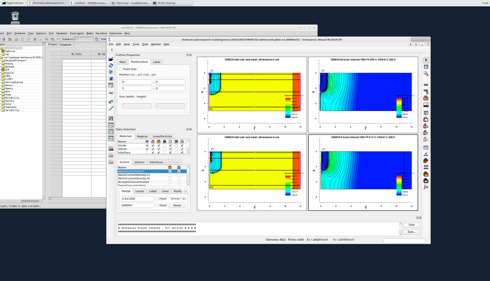

# VDMOS 0–60 krad 总剂量等效缺陷 TCAD 训练报告

## 摘要

本训练新建二维硅N沟道平面栅VDMOS对称半胞，采用不同深度、横向扩散的P-body与N+ source高斯掺杂，并以背景缺陷加剂量相关正氧化电荷及可充放电界面态表示辐照后的等效状态。真实Sentaurus W-2024.09完成0、10、20、30、40、50、60 krad(SiO2)下的转移与关断击穿扫描。按冻结定电流定义，主网格Vth由3.871339 V降至3.671610 V，变化−0.199729 V；BV由78.953690 V变为78.853823 V，下降约0.1265%。0/60剂量更细网格、减半步长复验均满足工程门槛，阈值变化及端点击穿差保持近似一致。报告保留真实逐点数据、提取括区、雪崩积分、原生场图和桌面证据，明确低电流数值噪声及模型缺项。这是未经实验校准的等效缺陷训练，不是商用器件复刻、实际辐照试验或抗辐照等级认证。

**关键词：** VDMOS；总电离剂量；氧化电荷；界面态；TCAD；可追溯训练。

### English abstract

A two-dimensional silicon n-channel planar VDMOS half-cell was constructed with distinct Gaussian body and source profiles. Post-irradiation conditions were represented by dose-dependent effective positive oxide charge and donor/acceptor interface states. Sentaurus W-2024.09 solved transfer and off-state breakdown characteristics at seven doses from 0 to 60 krad(SiO2). With explicitly defined current criteria and unit-depth normalization, the nominal threshold voltage decreased from 3.871339 V to 3.671610 V, whereas breakdown voltage changed from 78.953690 V to 78.853823 V. Refined meshes and reduced voltage steps at both endpoints reproduced the threshold shift and the small endpoint breakdown difference. Archived solver samples, extraction brackets, impact-ionization diagnostics, native field exports, and genuine desktop captures provide traceability. The results describe an uncalibrated training scenario, not measured irradiation response or a validated commercial-device radiation rating.

## 1. 训练目标、范围与文献证据

目标是打通“文献方法→明确假设→真实建模与求解→有定义的提取→数值检查→结果分析→最简复用”流程，而不是先画出预期曲线，再寻找参数使其吻合。训练要求包括七剂量ID–VG、每剂量关断击穿、BV–剂量、数据整理、报告和可复用记录。所有复杂建模、实际桌面操作、物理决策与文档均由当前gpt-6.1-sol主Agent执行；普通worker仅验证解析、数值契约及归档/CSV一致性。工具没有可核实的slow代理运行配置，因此没有把提示词中的模型名称当作配置证明。

文献提供的是不同层级的证据。高博等VDMOS辐照研究[R1]支持上部body/source、栅、外延和底部漏极拓扑，也说明阈值、击穿的测试偏置和电流定义必须同时读取；但其400/500 V型号、Gy(Si)剂量、辐照偏置及退火条件不是本训练的校准数据。Schwank的MOS氧化物机制综述[R2]提供生成关系与正电荷/界面态机制，不提供一套适用于所有工艺的缺陷剂量系数。非均匀界面态研究[R3]提醒能级分布、俘获与输运机制的重要性；本训练没有实现其完整模型。Silvaco VDMOS研究[R4]提供双扩散和转移扫描的思路，不能把不同工具、可疑单位或不完整工艺尺寸直接迁移。

公开Sentaurus教程[T1–T3]用于核对区域、接触、高斯掺杂、陷阱单位和击穿方法。安装版示例另用于查证当前版本语法及雪崩积分换算。UCF超结VDMOS学位论文只获得摘要，全文下载返回HTTP403，未臆造尺寸或掺杂。Gao论文中文文字提取乱码后，实际渲染原PDF第2–3页检查结构、表格和条件。详细阅读范围、原文链接及采用/未采用内容见[文献矩阵](literature.md)。本报告不宣称学生已完成课程中英文各10篇阅读、专题演讲或AI/人工对照实验。

## 2. 模型构建与辐照等效方法

### 2.1 几何、掺杂与接触

选择宽5 µm、深12 µm的二维对称半胞，底部y=11–12 µm为N+漏区，N-漂移背景为5e15 cm^-3。栅氧厚50 nm，覆盖x=1.5–5 µm；栅电极位于氧化层顶边。硅上表面x=0–1.5 µm的同一源接触覆盖P+ body接触及N+ source，避免把body留成未定义浮体。底边为drain，两侧采用默认绝缘/反射边界。源极、漏极、栅极接触的实际定义可直接从[geometry.scm](model/geometry.scm)核对。

P-body峰值3e17 cm^-3，在1.5 µm深处降至5e15，横向因子0.6；N+ source峰值1e20，在0.25 µm深处为1e17，横向因子0.5。不同纵向与横向扩散使栅下存在横向body沟道，而不是把整个表面变成一个N+短路区。P+接触区是训练简化，不等同于实际implant、退火和接触工艺。

建模后读取真实网格净掺杂与切线。表面y=0.01 µm的实际导出中，x≈0.156 µm为净P+，x≈0.867 µm为净N+，x≈2.031 µm仍为净P，x≈2.981 µm已进入净N漂移区，证明结构包含body/source及栅下过渡，而非仅靠示意图判断。完整表面和四条深度切线保存于[data/](data/)。净掺杂为施主减受主，负值并非“负浓度错误”。

图1为基线run的真实网格原生净掺杂导出，坐标单位µm。Visual当前视图横轴显示几何深度Y、纵轴显示横向X，不能因为屏幕方向而交换deck坐标。主网格有4296个点，更细端点网格有10905个点；GUI的含边界元素计数不直接当作求解网格单元数。几何及掺杂值均为训练假设，没有通过拟合声称恢复某型号的真实制造结构。

### 2.2 剂量、氧化电荷与界面态

剂量固定为krad(SiO2)，1 krad=10 Gy，计算中D_rad=1000D_krad。R2给出的氧化物生成关系结合有效产额和俘获比例，形成

`ΔN_ot = g0 × D_rad × t_ox × Y × f_trap`。

本次g0=8.1e12 cm^-3 rad^-1、t_ox=5e-6 cm；Y=0.6和f_trap=0.1是明确披露的未校准训练假设。于是ΔN_ot=2.43e9D_krad cm^-2，叠加背景正电荷5e10 cm^-2。在60 krad，正电荷输入为1.958e11 cm^-2，增量为1.458e11 cm^-2。0剂量含背景缺陷，不是“完全无陷阱”的理想器件。

氧化正电荷以Silicon/Oxide接口FixedCharge等效靠近界面的俘获电荷，没有解析体陷阱的空间分布。界面态总输入N_it=1e10+2e9D_krad cm^-2，一半为下半带donor Level，另一半为上半带acceptor Level；相对禁带中点分别为−0.25和+0.25 eV，电子/空穴俘获截面均1e-15 cm²。Level的Conc单位为cm^-2，不能与连续分布态的cm^-2 eV^-1混用。占据由稳态解决定，不强制满占据。

本次同时随剂量增加N_ot与N_it，是一个固定配方的剂量情景，不是对两机制独立贡献的因果分解。没有模拟辐照过程、剂量率、退火、位移损伤或单粒子效应；没有额外添加无来源硅体深能级。接口字段及非零e/h俘获电荷在真实TDR和栅接口切线中存在，60剂量非零区域位于x≈1.504–5 µm，符合栅氧位置。导出包含边界两侧重复坐标，原始行保留；不把某一个显示字段无条件等同于输入N_it或用于反推校准面密度。

### 2.3 物理与数值设置

开启Fermi统计、OldSlotboom、DopingDep/Enormal/HighFieldSaturation迁移率与SRH(DopingDep)，温度300 K，AreaFactor=1。击穿加入Avalanche(ElectricField)、AvalDerivatives及外接漏电阻。Enormal使迁移率响应法向场，但没有专门校准辐照接口电荷库仑散射，不能宣称预测了真实迁移率退化的完整幅度。栅Barrier=−0.55 eV采用安装版MOS/BV示例思路，不是为制造辐照趋势而拟合。

求解按Poisson→Poisson/Electron/Hole初始化→目标偏压顺序进行。runner保持单线程、单核affinity和锁；结构与电学依赖串行。相同主网格几何输入哈希在七剂量间完全一致，生成器版本也一致；剂量改变的是有效缺陷输入，不同时改沟道长度、掺杂、温度或功函数。冻结细节见[plan.md](plan.md)。

## 3. 实际执行、提取口径与来源控制

七剂量主扫描与0/60细化端点共九个独立run，原始归档留在`local_runtime/runs/<run_id>/`。基线pilot复用为0剂量，不重复计数。清单见[run-index.json](run-index.json)；每份归档保留输入SHA256、runner版本、实际步骤、退出码和结果SHA256。`COLLECTED`只代表执行与回传成功，后处理还逐一核对工具完成标志、偏置终点、数据有限性、电流守恒及提取括区。

ID–VG固定内部VDS=0.1 V，外加VGS从0到10 V，主扫描最大栅步进0.1 V。横轴使用gate OuterVoltage；栅势垒使InnerVoltage与外加栅压不同，若用错会引入0.55 V偏移。前缀`idvg_`文件的首点不是0，后处理在核对列名和VDS后接入初始化PLT最后一个真实零栅压样本。来源记录在summary中，没有补造零电流点。

Vth定义为ID第一次上穿1e-7 A/µm的电压，BV定义为关断ID第一次上穿1e-6 A/µm时的内部漏压。只在实际相邻样本间对标量作对数电流插值并保存括区；导出CSV不增加插值求解点。二维半胞电流按1 µm出平面深度报告A/µm，不乘未知胞数或芯片面积包装成整芯片安培。

击穿采用漏串联1e7 Ω·µm的外接电阻，电源目标1000 V，主扫描最大电源步进5 V，端电流达到5e-6 A/µm安全停止。横轴及BV必须用drain InnerVoltage，而非OuterVoltage。九个归档的全部击穿样本满足外部与内部漏压差等于I×R的关系，验证最大绝对差约1.10e-7 V。基线最后内部漏压79.514400 V、60剂量79.397715 V是安全停止点，**不是**提取BV；例如基线BV约78.953690 V，定义与终点不同。

最初后处理误把安全停止当缺少扫完标志，已用同一真实日志复现并修正：允许仅击穿路径的已声明电流停止，同时仍要求正常simulation finished与实际电流终点。GUI键盘输入退出0也不等于图形脚本成功；本次专门核对完成证明、导出时间、PNG和桌面，保留失败的美化尝试而没有重标成功。

## 4. 七剂量实际结果

### 4.1 标量汇总

下表是主网格结果；表中小数用于与CSV对照，不代表同等精度的真实器件预测。完整原始括区与来源见[data/summary.json](data/summary.json)，便于查算的表见[data/scalars.csv](data/scalars.csv)。

| 剂量 / krad(SiO2) | Vth / V，ID=1e-7 A/µm | BV / V，ID=1e-6 A/µm | ID(VGS=10 V) / A/µm |
|---:|---:|---:|---:|
| 0 | 3.871339 | 78.953690 | 2.560376e-6 |
| 10 | 3.839208 | 78.937153 | 2.563042e-6 |
| 20 | 3.804986 | 78.920274 | 2.565687e-6 |
| 30 | 3.771396 | 78.902795 | 2.568312e-6 |
| 40 | 3.739255 | 78.886969 | 2.570917e-6 |
| 50 | 3.705061 | 78.870700 | 2.573502e-6 |
| 60 | 3.671610 | 78.853823 | 2.576067e-6 |

### 4.2 转移特性与阈值

**观测：** 七条转移曲线在开启区向较低外加栅压移动，0→60剂量Vth变化−0.199729 V，约−5.159%。VGS=10 V的漏电流只增加约0.6128%，并不是所有电流区都同比增加；线性图中的大电流曲线接近重合，半对数图更容易看出开启位置差别。

**[推断]：** 正氧化电荷提高N沟道形成的易度，其负阈值移动趋势与R2机制一致。作为量级检查，50 nm氧层的理想平板Cox约6.91e-8 F/cm²，本次增量面正电荷若单独通过−qΔN/Cox作用，对应约−0.338 V；实际联合缺陷VDMOS得到约−0.200 V，不能把差额全部指定成某一个界面态贡献。沟道几何、能级占据、二维电势及定电流定义都可能参与，当前没有“只氧化电荷/只界面态”独立对照来分解它们。

**[推断]：** 强开启区相对差较小，与漂移区和其他串联电阻仍限制电流相容，但没有单独提取各电阻或证明精确比例。更不能把本次强开启电流略增解释为辐照提高了载流子本征迁移率；缺陷散射模型并未完整校准。

低栅压处保留可见的抖动与电流符号变化，原始0 V漏电流处于约1e-17–1e-15 A/µm，而本次守恒绝对容差为1e-12 A/µm。**[推断]** 该极低电流区的尖峰和排序容易受有限数值精度影响；本报告不据此预测真实关断漏电、精密亚阈值摆幅或检测极限。未通过平滑、裁点或人工设零使图看起来更好。

### 4.3 击穿特性与雪崩证据

**观测：** 主网格BV整体约79 V，0→60剂量减少0.099866 V，约0.1265%。曲线接近重合；BV–剂量图纵轴刻意展示小范围差别，不能把视觉斜率误读成严重耐压损伤。单个10 krad间隔的主网格差约0.016–0.017 V，还必须与数值偏移比较。

电流超过阈值还不足以宣称雪崩。本次读取`IntegrSemiconductor ImpactIonization`，依安装版BVmethods示例，用几何单位换算`I_II = integral × q × 1e-12`。基线BV两侧实际内部电压78.936234与78.971288 V，对应生成电流/端电流比约1.00027；60剂量括区78.831056与78.864017 V的比值也约1.00027。比值略大于1的差约0.03%，不当作超精确守恒证明，但已远不同于仅泄漏超过阈值的情形，支持本模型该区间由冲击电离主导。原积分、换算结果及实际采样点完整保留；更细网格比值也通过工程范围检查。

基线最后安全停止点的**硅**最大场为3.57517e5 V/cm，60剂量为3.57737e5 V/cm，最大值位置均在(x≈2.1094,y≈1.2680) µm附近；这与body结附近场集中相容。以上来自半导体专用PLT字段。原生全域场图的最高色标约8.69e5/9.33e5 V/cm，包含氧化层，不能拿来当硅雪崩临界场。两图还是不同内部电压的最终解，不是严格等压电场对照，也不是刚好位于插值BV的TDR。

**[推断]：** 在本配方和无终端半胞中，新增界面/近界面电荷对body结及漂移耐压的影响弱于对开启电势的影响，因此阈值变化明显而BV基本稳定。R1也提示阈值与击穿不必同幅变化，但其工艺、介质和测试条件不同，不能据此宣称本模型已复现实验。真实芯片场氧、终端、三维胞和封装缺失，当前约79 V不是400/500 V商用型号的额定耐压，更不能外推为真实器件抗辐照结论。

## 5. 数值质量、预算与验收边界

### 5.1 两端点网格/步长复验

保持物理输入与生成器一致，网格尺寸缩为0.7倍、扫描最大步长减半，另开两个run。主网格4296点、细化10905点；同时改变网格和步长只能检验这组联合细化，不能独立分离两者误差来源。

| 剂量 | 细化Vth / V | 细化BV / V | 与主网格Vth绝对差 / V | ID(10 V)相对差 | BV相对差 |
|---:|---:|---:|---:|---:|---:|
| 0 | 3.872536 | 78.915420 | 0.001197 | 0.03381% | 0.04847% |
| 60 | 3.672753 | 78.813585 | 0.001143 | 0.02970% | 0.05103% |

两项满足冻结门槛：Vth差≤0.05 V、ID相对差≤5%、BV相对差≤5%。[resolution-check.json](data/resolution-check.json)保存未四舍五入数值与run关系。所有九个run的数据有限，电流守恒检查通过；实际最坏残差约1.40e-19 A/µm（转移）和1.30e-19 A/µm（击穿）。这说明端子数值平衡，不证明所有物理模型准确。

更重要的是把数值变化与效应本身比较：细化令绝对BV下降约0.0383/0.0402 V，这超过一个10 krad间隔的主网格差，但小于整个0→60剂量差。联合细化下端点BV差为−0.101835 V，接近主网格−0.099866 V；阈值端点差为−0.199783 V，接近−0.199729 V。由此可以说“端点阈值负移和很小的BV端点差在这组复验中保持”，不能把每个剂量间隔的百分位毫伏当已确定实验精度，也不能把两档检查称为严格网格独立或统计显著性检验。

### 5.2 实际成本与异常记录

基线转移/击穿工具wallclock为53.68/118.24 s；细化0剂量为283.25/369.88 s，细化60剂量为247.69/285.59 s。后续八个串行run的runner总墙钟为2326.20 s（约38.77 min），含SDE、回传等开销；这是该批次实际命令时间，不是Agent阅读写作耗时或AI/人工效率对比。

细化完整run超过原计划单轮8 min上限，是实际执行控制偏差，不属于“所有预算均通过”：仅转移与击穿工具耗时之和，0端点已达653.13 s，60端点达533.28 s，尚未计SDE及归档。串行预提交没有在每个run落实8 min总时限检查，因此未按原单轮上限停止；该偏差明确保留，不把已完成的真实数据重标失败或伪造更短时间。观察偏差时最后端点已经运行，之后没有新增求解、调参或第三档扩展；整体求解仍在2 h总预算内。复用时应按细化成本单独估算，并把硬预算检查落实到提交控制，不能用断开SSH冒充停止远端求解。客户机locale及缺失devtoolset profile警告原样保留，没有修改商业工具、许可证、时间或屏蔽原始日志。

### 5.3 最小充分验证与未验证项

7项解析/数值单元测试通过；只读归档审查逐一重读9个run与18份电学CSV，数值逐项与真实样本完全一致，输入几何及生成器哈希一致，电阻电压关系与雪崩诊断通过。主Agent另核对5幅电学图、原生场图、接口切线和真实桌面。所有验证只覆盖可观察工程契约，不用源码文字或漂亮截图替代求解证据。

尚未验证真实工艺尺寸/掺杂、实验剂量–缺陷校准、连续界面能级分布、完整辐照库仑散射、剂量率/退火、温度/自热、芯片终端、3D胞与面积归一化，也没有完成不同击穿模型、三个以上网格层次或独立网格/步长研究。因此“工程链路及约定质量门槛通过”“本训练参数下出现这些趋势”“真实器件科学结论成立”必须分别表述。没有未收敛结果被当成有效点，没有把1000 V电源目标当实测BV，也没有合成曲线补齐扫描。

## 6. 实际麻烦、解决与可复用经验

训练遇到的主要麻烦不是求解器崩溃，而是证据与口径容易被误读：论文PDF能下载不等于可读正文；摘要能读不等于知道工艺；安全停止不等于失败；内部栅势不等于外加栅压；前缀文件不一定包含初始点；原生标量默认颜色不一定是电场；手册通用属性列表不保证适用于二维图；全域最高场不等于半导体峰值。

处理采用明确的最小修正：对乱码渲染原页；访问失败标阅读范围；独立venv避免破坏主机；读取工具日志和PLT验证正常安全停止；迁移横轴及初始点来源；关闭旧标量再显示目标量；删除被实际二维验证拒绝的美化属性；以半导体字段及积分检查击穿。早期失败与修正前后截图留在本机运行资料，不修改原始解来伪装修复。详细“场景→证据→原因→处理→复验→边界”见[lessons.md](lessons.md)。

图中上排为60剂量、下排为0剂量的真实结构/最终场解；标题注明内部VDS。背后的Workbench仍是空白节点工程，本训练并未通过它的Run按钮执行求解，不能用该窗口证明Workbench调度已验收。清除的是本任务GUI控制台显示历史用于最终取证，失败截图和原始日志保留。没有重启/关闭用户VM或已有Workbench会话。

## 7. 结论与后续适用方式

1. 已完成独立VDMOS半胞、七剂量转移/击穿、两端点数值复验、逐点数据与有括区提取、真实原生图和桌面、文献与最简复用文档。
2. 在所披露的等效缺陷配方下，0→60 krad(SiO2)阈值负移约0.200 V，强开启电流只增约0.613%；没有证据把该变化解释为真实迁移率改善。
3. 约79 V的电流判据BV在七剂量间基本稳定，端点下降约0.100 V；雪崩积分支持阈值附近冲击电离主导。联合细化保持端点差，但不足以给每个小剂量间隔赋予实验精度。
4. 本训练可复用的是结构核对、单位/缺陷口径、串行真实求解、归档、提取、数值检查与取证方法。不能直接复用本次数值作为商用品测量、实际辐照响应、航天适用性或AI优于人工的证明。

面向下一次不同器件，应先获得工艺和辐照/测量条件，再校准结构与缺陷参数；若要分解氧化电荷与界面态贡献，应设计独立对照，而不是把当前联合情景反推成唯一机制。方法速览见[methods.md](methods.md)，已实测操作入口见[workflow.md](workflow.md)，完整交付导航见[README.md](README.md)。

## 参考资料

- [R1] 高博等，国产星用VDMOS器件总剂量辐射损伤效应研究，物理学报61(17),176107,2012。[DOI](https://doi.org/10.7498/aps.61.176107)。实际核对原PDF页面，不能只用乱码提取。
- [R2] Jim Schwank，Radiation Effects in MOS Oxides，SAND2007-3309C。[Sandia/OSTI原文](https://www.osti.gov/servlets/purl/1147853)。报告编号为2007，不以本机旧下载文件名判年份。
- [R3] Modeling of total ionizing dose effects on the nonuniform distribution of Si/SiO2 interface trap energy states in MOS devices，Scientific Reports15,17082,2025。[全文](https://pmc.ncbi.nlm.nih.gov/articles/PMC12084595/)，[DOI](https://doi.org/10.1038/s41598-025-01325-3)。
- [R4] Bella、Ghoumazi，I_V Characteristic of Vertical Double Diffused Metal Oxide Semiconductor (VDMOS) Power Transistor Using Silvaco-TCAD，2022。[DOI](https://doi.org/10.18280/ejee.240407)，[全文](https://www.iieta.org/download/file/fid/82487)。
- [T1] Sentaurus Training：[区域/接触](https://ghzphy.github.io/Sentaurus_Training/sde/sde_2.html)、[掺杂](https://ghzphy.github.io/Sentaurus_Training/sde/sde_3.html)、[网格](https://ghzphy.github.io/Sentaurus_Training/sde/sde_4.html)。
- [T2] Sentaurus Training：[Traps](https://ghzphy.github.io/Sentaurus_Training/sd/sd_13.html)。
- [T3] Sentaurus Training：[Breakdown](https://ghzphy.github.io/Sentaurus_Training/sd/sd_11.html)。
- 安装版Sentaurus W-2024.09：BVmethods示例与Visual手册附录用于版本语法核对，受限手册副本仅存私有运行目录，不入库；它们不计作已完成阅读的研究论文。
